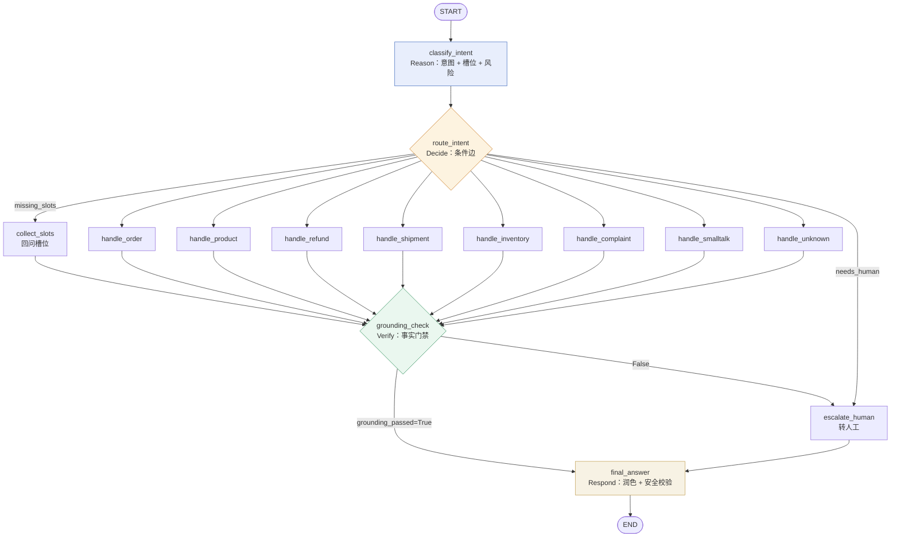
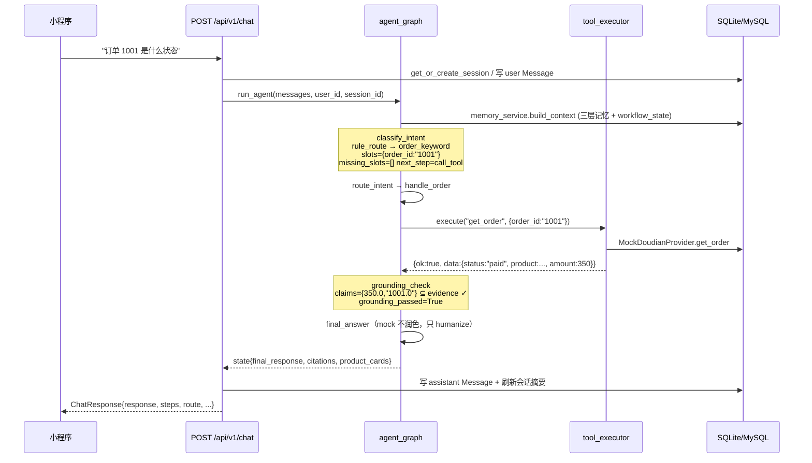

# 如何用 LangGraph 搭一个 ReAct 式 Agent —— 星途客服小程序源码分析

> 本文只分析**已经写在仓库里的代码**，所有结论都标注了文件与行号。文中的「本仓库」指 `星途客服小程序/`，后端代码在 `backend/app/`。
>
> 阅读顺序建议：第 1、2 节建立整体认知 → 第 3 节回答「为什么不用现成的」→ 第 4~8 节按 ReAct 的四个阶段逐个拆解 → 第 11 节看第二份实现 → 第 12、13 节是选型与取舍。

---

## 0. 摘要：三句话讲清本项目的做法

1. **主链路是一张手搭的 LangGraph 有向无环图（14 个节点）**，用 `StateGraph(AgentState)` 建模「一次客服请求」的全过程，**没有**使用 `langgraph.prebuilt.create_react_agent`，也没有 `ToolNode` / `tools_condition`（全仓库 `grep` 只有 `StateGraph, START, END` 三个导入）。
2. **它仍然是 ReAct 式的**：`classify_intent`（Reason）→ `route_intent` 条件边（Decide）→ `handle_*` + `tool_executor`（Act）→ `tool_results/retrieved_chunks` 写回 State（Observe）→ `grounding_check`（Verify）→ `final_answer`（Respond）。区别在于 **Reason 由「规则优先 + LLM 兜底」的 `IntentRouter` 承担，而不是让 LLM 在自由循环里自己决定调什么工具**。
3. **仓库里还有第二份实现 `core/react_agent.py`**，那是一份标准的 function-calling ReAct 循环（`Thought → tool_calls → Observation`，`MAX_REACT_STEPS=3`）。它当前**没有被主图调用**，是同一套工具集之上的「自主循环版」，本文第 11 节给出把它接进图的两种改法。

一句话总结设计取向：**用确定性的图结构换可控性，把「自由 ReAct」降级为「受控 ReAct + 独立验证节点」。**

---

## 1. 概念对齐：ReAct 的每一步在 LangGraph 里对应什么

ReAct（Reason + Act）的原始形态是一个 while 循环：

```
while not done:
    thought  = LLM(question, scratchpad)     # Reason
    action   = parse(thought)                # Decide
    obs      = run_tool(action)              # Act
    scratchpad += (thought, action, obs)     # Observe
answer = LLM(question, scratchpad)           # Respond
```

LangGraph 把「循环」拆成了**显式的节点 + 边 + 共享状态**。映射关系如下（右列全部是本仓库的真实实现）：

| ReAct 概念 | LangGraph 原语 | 本仓库实现 | 位置 |
| --- | --- | --- | --- |
| Scratchpad / 工作记忆 | `State`（TypedDict） | `AgentState`（28 个字段） | `agent/state.py:13` |
| Thought（这一步该怎么想） | 节点 | `classify_intent` → `IntentRouter.route()` | `agent/nodes.py:208`、`core/intent_router.py:231` |
| Decide（下一步做什么） | **条件边** | `add_conditional_edges("route_intent", nodes.route_intent, route_map)` | `agent/graph.py:63` |
| Act（调用工具） | 节点 | `handle_*` → `tool_executor.execute()` | `agent/nodes.py:283` 起 |
| Observation（观测结果） | State 字段 | `tool_results` / `retrieved_chunks` / `citations` | `agent/state.py:32-34` |
| Verify（自我校验） | 节点 | `grounding_check` | `agent/nodes.py:581` |
| 是否还要再循环一轮 | 条件边 / `END` | `grounding_passed` 分流 `final_answer` / `escalate_human` | `agent/graph.py:68` |
| Respond | 节点 | `final_answer` | `agent/nodes.py:637` |
| 「循环次数上限」 | 状态计数 | `iteration` / `max_iterations=3` | `agent/nodes.py:210` |

> **关键差异**：标准 ReAct 的「下一步做什么」是 LLM 输出的一句话；本项目的「下一步」是 `route_intent(state)` 这个 Python 函数根据 `state["intent"]` / `state["missing_slots"]` 返回的一个节点名（`agent/nodes.py:252`）。也就是说，**决策被编译成了代码，而不是提示词**。



**节点清单（`agent/graph.py:30-46` 注册的 14 个）**：

```
classify_intent, route_intent, collect_slots,
handle_order, handle_product, handle_refund, handle_shipment,
handle_inventory, handle_complaint, handle_smalltalk, handle_unknown,
grounding_check, escalate_human, final_answer
```

---

## 2. 两份实现的全景图

```mermaid
flowchart LR
    subgraph A["① 主链路：受控 ReAct（LangGraph 状态机）"]
        direction TB
        A1["run_agent()<br/>注入 memory_context"] --> A2["agent_graph.ainvoke(state)"]
        A2 --> A3["14 节点 / 2 条件边"]
        A3 --> A4["tool_executor<br/>参数校验·重试·审计"]
    end
    subgraph B["② 备选：自主 ReAct（function calling 循环）"]
        direction TB
        B1["ControlledReActAgent.run()"] --> B2{"tool_name 已定？"}
        B2 -->|是| B3["direct_tool<br/>直接执行，不走 LLM"]
        B2 -->|否| B4["LLM function calling<br/>最多 3 步"]
    end
    A4 -.同一套工具注册表.-> B3
    B4 -.tool_executor.execute.-> A4

    style A fill:#f4f8ff,stroke:#4a72c0
    style B fill:#fdf9f0,stroke:#c9781f
```

| 维度 | ① `agent/graph.py`（主链路） | ② `core/react_agent.py`（备选） |
| --- | --- | --- |
| 控制流 | 图（DAG，显式节点/边） | `for step in range(MAX_REACT_STEPS)` 循环 |
| Reason 由谁做 | `IntentRouter`（规则优先 + LLM 兜底） | LLM 自己选工具（function calling） |
| 是否走 LLM | `mock` 模式 0 次；DeepSeek 模式 0~2 次 | mock 模式 0 次（短路）；真实模式 ≥1 次 |
| 工具调用 | `handle_*` 直接 `tool_executor.execute()` | LLM 产出 `tool_calls` → `execute()` |
| 超步处理 | `iteration > max_iterations` → 转人工 | `MAX_REACT_STEPS` 用尽 → `stop_reason="max_steps"` + `handoff_requested` |
| 校验 | `grounding_check` 独立节点 | 无（依赖调用方） |
| 是否被主图调用 | — | **否**（`grep -rn "react_agent"` 除自身外无引用） |

---

## 3. 为什么不直接用 `create_react_agent`

本仓库**有条件**用现成件（依赖里有 `langgraph`），但没有用。原因在代码里可以直接读出来：

### 3.1 写操作必须「人审」，不能由 LLM 自由触发

`process_refund` / `process_shipment` 在注册表里是 `risk_level="write"`（`core/tool_registry.py:26-27`），实现上**只创建 `HumanTask`，不做真实写操作**：

```python
# core/tools.py:12 —— 任何写操作必须先经过审批
async def create_human_task(task_type: str, payload: dict) -> str: ...

# core/tool_registry.py:129 —— 写工具 = 建任务
async def _create_refund_task(params):
    task_id = await create_human_task("refund", {...})
    return {"status": "pending", "task_id": task_id}
```

而 `handle_refund` 在处理完后立刻把状态置为 `needs_human=True`（`agent/nodes.py:353`）。这是一条**业务规则**，写成图里的节点比写成提示词「请不要自动退款」可靠得多。

### 3.2 「事实门禁」必须插在答复之前

`grounding_check`（`agent/nodes.py:581`）要求答案中的价格/库存/订单号/状态都能在 `tool_results`、`retrieved_chunks`、`citations`、`human_task_id` 里找到（`core/grounding.py:64-79`）。这是**独立于 LLM 的一个校验步骤**——在自由 ReAct 里你只能把这句话写进 system prompt，然后祈祷模型听话。

### 3.3 「转人工」是一等业务状态，不是「再试一次」

`escalate_human` 会创建 `HumanTask` 并把会话置 `waiting`，由管理员工作台接管（`agent/nodes.py:605`）。在 ReAct 里这只是一个 tool；在本项目里它是一条**终态边**（`grounding_check → escalate_human → final_answer → END`）。

### 3.4 成本与延迟

`mock` 模式下整条链路 **0 次 LLM 调用**（`agent/llm.py:216-220`、`:223-227`）；DeepSeek 模式下通常 **1~2 次**（意图兜底 + 最终润色）。若改成 function-calling ReAct，最少的订单查询也要 **2 次**（一次决定调工具、一次根据观测作答），多工具场景线性增长。

### 3.5 可测试

因为控制流显式、状态就是普通字典，`backend/tests/test_agent.py` 可以直接调 `run_agent()` 跑**真实的图**，再对返回的 state 断言，全程不需要 mock LLM（默认 `llm_provider=mock`）：

```python
# tests/test_agent.py:12
async def test_order_intent_returns_order_info():
    state = await run_agent([{"role": "user", "content": "查一下订单 1001"}], "1")
    assert state["intent"] == "order"
    assert "1001" in state["final_response"]
    assert state["tool_results"][0]["ok"] is True

# tests/test_agent.py:31 —— 门禁可以单独拿出来测，手工构造 state 即可
def test_grounding_rejects_unverified_fact():
    state = {"final_response": "该商品库存 888 件，请放心购买。",
             "tool_results": [], "retrieved_chunks": [], "citations": []}
    assert check_grounding(state)["ok"] is False
```

该文件共 29 个用例，覆盖订单查询、退款建单、门禁（含「口语数字不误拦」）、离题确认转人工、多轮记忆追问、卡片名称软化等。若换成自由 ReAct，要稳定复现同样的断言就得连 LLM 的采样一起 mock 掉。

> **代价**：新增一个「自主决策」场景（例如让 LLM 组合多个工具）需要改图；这正是 `react_agent.py` 存在的意义——两种形态并存，按场景选。

---

## 4. ① Reason：把 Thought 做成一个「受控规划器」

### 4.1 节点只做三件事

```python
# agent/nodes.py:208
async def classify_intent(state):
    iteration = int(state.get("iteration") or 0) + 1
    if iteration > max_iterations:            # 防御：超步 → 转人工
        ...  # needs_human=True + HumanTask
    wf_state = state.get("memory_context", {}).get("workflow_state", {"phase": "idle"})
    decision = await _intent_router.route(message, wf_state)      # ← 真正的"思考"
    return {
        "iteration": iteration,
        "intent": INTENT_MAP.get(decision.intent, "unknown"),
        "slots": decision.slots,
        "missing_slots": decision.missing_slots,
        "action": decision.action,
        "next_step": decision.next_step.value,
        "reason_code": decision.reason_code,
        "resolved_query": expand_query(message, wf_state),        # 指代消解
    }
```

### 4.2 `RouteDecision` = 结构化的 Thought

```python
# core/intent_router.py:34
@dataclass
class RouteDecision:
    intent: Intent                      # 8 类意图
    action: str                         # order_query / refund_only / knowledge_query ...
    slots: dict[str, str] = field(default_factory=dict)
    missing_slots: list[str] = field(default_factory=list)
    risk_level: str = "low"
    next_step: NextStep = NextStep.DIRECT_REPLY
    reason_code: str = ""
```

`NextStep` 枚举（`core/intent_router.py:23`）已经把「下一步动作」显式化了：`DIRECT_REPLY / RETRIEVE_KNOWLEDGE / CALL_TOOL / COLLECT_SLOTS / COLLECT_CLARIFICATION / PREPARE_AFTER_SALES / TRANSFER_TO_HUMAN`。

> **这就是把 ReAct 的隐式推理显式化的关键**：模型（或规则）不输出自然语言，而是输出一个可校验、可断言、可写进日志的结构体。`reason_code` 会一路带到 `final_answer`，并作为 `steps_from_state()` 的展示内容（`agent/graph.py:145`），也用于 `should_skip_polish()` 判断是否需要润色（`agent/nodes.py:618`）。

### 4.3 路由顺序：状态 → 记忆 → 规则 → LLM

`IntentRouter.route()`（`core/intent_router.py:231`）的优先级链条，每一步都有明确目的：

| 顺序 | 判断 | 目的 | 代码 |
| --- | --- | --- | --- |
| 1 | `from_state()`：`phase == awaiting_order_id / awaiting_after_sales_confirmation / awaiting_handoff_confirm` | **流程状态优先**，让上一轮的追问能被这一轮接住 | `:111` |
| 2 | `is_recall()`：用户说「刚才那款」 | 记忆召回 | `:239` |
| 3 | `expand_query()` + `is_followup()` | 指代消解（「它」「这款」补全成具体商品/订单） | `:243-248` |
| 4 | `rule_route()`：关键词规则表 | **规则优先**：转人工 → 离题 → 投诉 → 退款 → 物流 → 库存 → 订单 → 知识 → 寒暄 | `:155` |
| 5 | 规则全不中 | 才调 LLM 分类 | `:203` |

规则表本身也有「业务优先级」的设计，例如同一句里既有「退款」又有「流程」时，判知识问答而不是走退款工单：

```python
# core/intent_router.py:164 —— 政策问句 vs 动作意图
if any(w in normalized for w in REFUND_KEYWORDS):
    if any(w in text for w in POLICY_QUESTION_HINTS) and "订单" not in text:
        return RouteDecision(Intent.KNOWLEDGE_QUERY, "knowledge_query", ...,
                             next_step=NextStep.RETRIEVE_KNOWLEDGE,
                             reason_code="refund_policy_keyword")
```

### 4.4 LLM 兜底只负责「分类」，不负责「选工具」

```python
# core/intent_router.py:203
async def llm_route(text, slots):
    if settings.llm_provider.lower() == "mock":
        return RouteDecision(Intent.UNKNOWN, "offtopic", slots,
                             next_step=NextStep.COLLECT_CLARIFICATION,
                             reason_code="offline_fallback")   # 离线：不联网，判离题
    ...
    data = json.loads(...)                                    # 要求模型只输出 JSON
    intent = Intent(intent_str) if intent_str in [...] else Intent.UNKNOWN
    step = NextStep(step_str) if step_str in [...] else NextStep.DIRECT_REPLY
    return RouteDecision(intent, data.get("action", "unknown"), merged_slots,
                         next_step=step, reason_code="llm_route")
```

LLM 输出被**双重白名单校验**（`intent_str`、`step_str` 必须在枚举里），解析失败还有三层回退：`llm_parse_fail → transfer_to_human`、异常 → `llm_route_fallback`、`mock` → `offline_fallback`。

**工具选择**由 `ACTION_TO_TOOL` 静态映射完成，模型根本没机会「发明」工具：

```python
# core/tool_registry.py:31
ACTION_TO_TOOL = {
    "order_query": "get_order",
    "logistics_query": "get_logistics",
    "inventory_query": "get_inventory",
    "knowledge_query": "search_knowledge",
    "refund_only": "process_refund",
    "return_refund": "process_refund",
    "shipment_request": "process_shipment",
}
```

---

## 5. ② Act：工具契约比「调用」更重要

### 5.1 工具是用元数据注册的，不是用 prompt 描述的

```python
# core/tool_registry.py:11-29
@dataclass(frozen=True)
class ToolDefinition:
    name: str
    risk_level: Literal["read", "write"]     # 决定是否重试、是否必须人审
    required_params: tuple[str, ...]         # 参数校验依据，同时用于生成 function schema
    timeout_seconds: float                   # 5.0（⚠ 仅声明，执行器未使用）
    max_retries: int                         # 读类 2，写类 0
    description: str

TOOL_REGISTRY = {
    "get_order":          ToolDefinition("get_order", "read", ("order_id",), 5.0, 2, ...),
    "get_logistics":      ToolDefinition("get_logistics", "read", ("order_id",), 5.0, 2, ...),
    "get_inventory":      ToolDefinition("get_inventory", "read", ("sku_id",), 5.0, 2, ...),
    "search_knowledge":   ToolDefinition("search_knowledge", "read", ("query",), 5.0, 1, ...),
    "process_refund":     ToolDefinition("process_refund", "write", ("return_order_no", "action"), 5.0, 0, ...),
    "process_shipment":   ToolDefinition("process_shipment", "write", ("order_id",), 5.0, 0, ...),
}
```

同一份定义被**三处复用**：① `ToolExecutor` 做参数校验与重试策略；② `_function_definitions()` 生成 OpenAI function schema（`core/react_agent.py:40`）；③ `/admin` 等接口展示风险等级。

### 5.2 执行语义：错误是数据，不是异常

```python
# core/tool_registry.py:66  ToolExecutor.execute
definition = TOOL_REGISTRY.get(tool_name)
if not definition:
    return self._result(..., "system_error", False, ..., "tool_not_registered", ...)
missing = [p for p in definition.required_params if not params.get(p)]
if missing:
    return self._result(..., "business_error", False, ..., "missing_parameter",
                        f"请补充：{'、'.join(labels)}", ...)
for attempt in range(definition.max_retries + 1):
    try:
        data = await self._invoke(tool_name, safe_params)
        ...
    except Exception as exc:
        if attempt + 1 == attempts:
            return self._result(..., "system_error", ..., "tool_exception", str(exc)[:200], ...)
```

有三点值得注意、一点需要指正：

1. **缺参返回 `business_error` 而不是抛异常** —— 这是「缺槽位回问」的数据基础，`collect_slots` 正是靠这类结果决定追问。
2. **每次执行都写审计**（`self.executions[run_id]`：execution_id、参数截断 120 字、retry_count、duration_ms、error），失败可复盘。
3. **工具层不抛异常到图里**：`run_tool()`（`core/tools.py:89`）用 `try/except` 把异常转成 `{"ok": False, "error": ...}`，保证 **Observation 永远是可序列化的数据**，`handle_*` 只需判 `result["ok"]`。
4. **⚠ 「超时」目前不生效（源码指正）**：`ToolDefinition.timeout_seconds` 只在 `core/tool_registry.py:15` 声明、`TOOL_REGISTRY` 里填了 `5.0`，但 `ToolExecutor.execute()` 里没有任何 `asyncio.wait_for` / `asyncio.timeout` 包裹——**这个字段从未被读取**。真实生效的超时只有两处：`DoudianOpenAPIProvider` 的 `httpx.AsyncClient(timeout=15.0)`（`core/doudian_provider.py:172`）与 `ChatOpenAI(timeout=20)`（`agent/llm.py:44-58`）。所以「工具超时 5 秒」是设计意图而非当前行为，答辩时不要当成已实现能力讲；要补上只需在 `_invoke` 外层加一层 `async with asyncio.timeout(definition.timeout_seconds)`。

### 5.3 节点里的 Act 长什么样

```python
# agent/nodes.py:283  handle_order
result = await tool_executor.execute("run_0", "get_order", str(state.get("user_id", "")), {"order_id": order_id})
if not result.ok:
    return {"order_id": order_id,
            "tool_results": [_tool_result_to_dict(result)],
            "final_response": f"很抱歉，未查询到订单 {order_id} 的信息。"}
order = result.data or {}
response = (f"订单 {order_id} 当前状态为{_status_cn(order.get('status',''))}，"
            f"商品：{order.get('product','')}，金额：{order.get('amount','')} 元，"
            f"客户：{order.get('customer','')}。")
```

注意 `user_id` 是**在闭包里绑定**的（`agent/nodes.py:293`），模型既看不到也改不了——这是「工具调用越权」的常见漏洞点在结构上的消除。

---

## 6. ③ Observe：State 就是那张 scratchpad

### 6.1 `AgentState` 的字段分组（`agent/state.py:13`，共 28 个字段）

| 分组 | 字段 | 作用 |
| --- | --- | --- |
| 对话与身份 | `messages` `user_id` `session_id` `memory_context` `resolved_query` | 输入、会话归属、三层记忆、指代消解后的问题 |
| 意图与槽位 | `intent` `slots` `missing_slots` `action` `next_step` `reason_code` `order_id` `product_query` | Reason 的产物（结构化 Thought） |
| **工具与依据** | `tool_results` `retrieved_chunks` `citations` `citations_detail` `relevance_score` `product_cards` | **Observation**，也是 grounding 的唯一依据 |
| 门禁与人工 | `grounding_passed` `needs_human` `human_task_id` `safety_blocked` `after_sales_preview_id` | Verify 与人工闭环 |
| 迭代与输出 | `iteration` `max_iterations` `final_response` `stream_final` | 循环控制与答复 |

嵌套的 `ToolResult` TypedDict（`agent/state.py:4`）就是 Observation 的 schema：

```python
class ToolResult(TypedDict):
    name: str          # 工具名
    arguments: dict    # 实参（审计与展示用）
    ok: bool
    data: Optional[dict]
    error: Optional[str]
```

### 6.2 Observation 不是「全塞回 prompt」

`llm.py` 里的 `_evidence_for_prompt()`（`agent/llm.py:84`）只挑**关键字段**进提示词：

```python
# agent/llm.py:67 —— 只把关键字段回灌给模型
def _compact_tool(result):
    keep = {k: v for k, v in data.items()
            if k in ("order_id", "status", "price", "stock", "sku_id", "logistics_code", "task_id")}
    ...
```

商品卡片则被压成 `1.太阳能柱头灯350元 太阳能 防水；` 这种一行式（`agent/llm.py:96-104`），并且**商品全称先被替换成「这款」**再进上下文——身份交给卡片，避免模型复述长名。

> 对比标准 ReAct：原始实现会把整段 Observation 追加进 scratchpad，token 线性增长。本项目的做法是「**状态全量保留（供门禁与审计），进模型前压缩（控制成本）**」。

### 6.3 记忆是「跨轮次的 Observation」

`run_agent()` 在 `ainvoke` 之前注入三层记忆与流程状态（`agent/graph.py:114-130`）：

```python
ctx = await memory_service.build_context(session_id, user_id, last_message)
initial = _initial_state(history or messages, user_id, session_id)
initial["memory_context"] = ctx      # recent_messages / summary / long_term / workflow_state
```

其中 `workflow_state` 是「上一轮问出去的话」：`collect_slots` 会写入 `phase="awaiting_order_id"`（`agent/nodes.py:275`），下一轮 `IntentRouter.from_state()` 就靠它把 `order_id` 续上（`core/intent_router.py:111`）。**这就是多轮 ReAct 的「跨请求 scratchpad」**，只不过持久化在数据库而不是内存里。

---

## 7. ④ Verify：ReAct 之外的第四步

标准 ReAct 只有三步（Reason-Act-Observe）。本项目插了第四步，且**它是独立节点**：

```python
# agent/nodes.py:581
async def grounding_check(state):
    check = check_grounding(state)
    if check["ok"]:
        return {"grounding_passed": True}
    cards = state.get("product_cards") or []
    if cards:                                   # 第一次失败：改用卡片话术重试
        listing = _card_listing(cards)
        answer = f"为您推荐这几款在售商品：{listing}。"
        retry = check_grounding({**state, "final_response": answer,
                                 "retrieved_chunks": chunks + [listing]})
        if retry["ok"]:
            return {"grounding_passed": True, "final_response": answer, ...}
    return {"grounding_passed": False, "needs_human": True,      # 仍失败：转人工
            "final_response": "我暂时无法确认，已为您转人工核实。"}
```

门禁的判定逻辑（`core/grounding.py:42-90`）体现了「只拦硬事实」的取舍：

```python
_PRICE_RE = re.compile(r"(\d+(?:\.\d+)?)\s*元")
_STOCK_RE = re.compile(r"库存\s*(\d+(?:\.\d+)?)")
_ORDER_RE = re.compile(r"(?:订单\s*|ORD-?)\s*(\d{3,})", re.I)
# 只把价格/库存/订单号当硬事实；「能用3年」这种口语数字不拦
claims    = _claim_numbers(answer) | _statuses(answer)
supported = _numbers(evidence) | _claim_numbers(evidence) | _statuses(evidence)
missing   = claims - supported
```

数字统一 `str(float(x))` 归一化（`"1001"` → `"1001.0"`），避免 `1001` 与 `1001.0` 的格式误判；证据来源是 `tool_results.data` + `retrieved_chunks` + `citations` + `human_task_id`（`core/grounding.py:64`）。

配套的安全层（`core/safety.py`）在**两侧**都设卡：

- 进模型前：`mask_sensitive()` 把订单号/手机号/地址替换为标记（`safety.py:12`）；
- 出模型后：`validate_customer_answer()` 检查是否泄露手机号/身份证/地址（`safety.py:27`），命中则替换为安全提示并转人工；
- `humanize_customer_text()` 去说明书腔 + `soften_catalog_names()` 把商品全称换成「这款/第N款」（`safety.py:46-78`）。

---

## 8. ⑤ Respond：润色与流式（两条出口）

`final_answer`（`agent/nodes.py:637`）区分了同步与流式两条路：

```python
response = state.get("final_response") or "我暂时无法确认，已为您转人工核实。"
# WS 流式路径跳过同步 LLM 润色，由 chat_ws 逐 token 推送
if not state.get("needs_human") and not state.get("stream_final") and not should_skip_polish(state):
    generated = await generate_chat_response(state)          # 非流式润色
    if generated and check_grounding({**state, "final_response": generated})["ok"]:
        response = generated                                 # 润色结果也要过门禁
...
return {"final_response": humanize_customer_text(response, cards), ...}
```

流式路径（`api/chat.py:160-290`）在 WebSocket 里把 ReAct 的各阶段**逐个暴露给客户端**：

| 事件 | 时机 | 内容 |
| --- | --- | --- |
| `status` | 收到消息 | `{"status": "started"}` |
| `thinking` | 图执行完 | `intent` / `reason_code` / `slots`（Thought 结果） |
| `tool` | 图执行完 | 每个 `tool_result` 的 name / arguments / result（Act + Observe） |
| `final_delta` | 润色中 | 逐 token 增量 |
| `final` | 落库后 | 完整答复 + `citations` + `product_cards` + `needs_human` + `relevance_score` |

注意流式分支还有一个**兜底校验**：`collected` 拼完后重新跑一遍 `check_grounding` 与 `validate_customer_answer`，任一项不过就丢弃生成结果、回退到规则草稿（`api/chat.py:230-256`）。**流式和门禁是正交的：能流式输出，不代表能跳过校验。**

---

## 9. 图是怎么搭起来的（逐行）

```python
# agent/graph.py:25
def build_graph():
    graph = StateGraph(AgentState)                    # 1. 声明状态契约

    for name in node_names:                           # 2. 注册 14 个节点
        func = nodes.route_intent_node if name == "route_intent" else getattr(nodes, name)
        graph.add_node(name, func)

    graph.add_edge(START, "classify_intent")          # 3. 入口边
    graph.add_edge("classify_intent", "route_intent")

    route_map = {name: name for name in handler_names + ["escalate_human"]}
    graph.add_conditional_edges("route_intent", nodes.route_intent, route_map)   # 4. 条件边①

    for name in handler_names:                        # 5. 9 个 handler 汇聚到门禁
        graph.add_edge(name, "grounding_check")

    graph.add_conditional_edges(                      # 6. 条件边②
        "grounding_check",
        lambda state: "final_answer" if state.get("grounding_passed") else "escalate_human",
        {"final_answer": "final_answer", "escalate_human": "escalate_human"},
    )
    graph.add_edge("escalate_human", "final_answer")
    graph.add_edge("final_answer", END)
    return graph.compile()

agent_graph = build_graph()                            # 模块级单例（:79）
```

四个工程细节：

1. **`route_intent` 节点是空操作**（`agent/nodes.py:261` 只回写 `intent`）——它存在的唯一目的是给条件边一个落点。这是 LangGraph 的常见写法：**路由函数（纯函数返回节点名）** 与 **节点函数（返回状态增量）** 分离。
2. **`route_intent(state)` 是纯函数**（`agent/nodes.py:252`）：`needs_human` → `escalate_human`；`missing_slots` 且意图属于四类 → `collect_slots`；否则 `INTENT_HANDLERS[intent]`。它不修改任何状态。
3. **`compile()` 在模块导入时执行一次**（`agent/graph.py:79`），运行时只 `ainvoke`，避免每次请求重建图。
4. **`_initial_state()` 显式给全部字段初值**（`agent/graph.py:82`），否则 `state.get()` 的默认值会散落在各节点里。

### 关于 `max_iterations` 的一个诚实结论

```python
# agent/nodes.py:210
iteration = int(state.get("iteration") or 0) + 1
if iteration > max_iterations:   # max_iterations = 3
    ...转人工
```

由于**这张图是无环的（DAG）**，且没有配置 checkpointer，一次 `ainvoke` 里 `classify_intent` 只会被访问一次，因此 `iteration` 恒为 1 —— `max_iterations` 目前是**防御性字段**，不是真实生效的循环上限。真正的多轮控制靠 `WorkflowState` + 会话历史（第 6.3 节）。

**这恰好解释了为什么 `react_agent.py` 要单独写一套**：ReAct 的本质是**环**（`act → observe → think → act`），要在 LangGraph 里表达环，需要一条从 handler 回到 `classify_intent` 的条件边。本仓库选择不在主图上开环，而是把环封装成普通 Python 循环（见第 11 节），从而保住主链路的可预测性。

---

## 10. 一次真实请求的完整轨迹

### 10.1 订单查询（命中规则，0 次 LLM）



`steps_from_state()`（`agent/graph.py:145`）会把这次执行还原成给前端看的步骤：`意图 → 槽位抽取 → 工具 get_order(arguments) → [转人工]`。**因为状态即草稿纸，轨迹不需要额外埋点就能重建。**

### 10.2 退款（写操作 + 人审 + 转人工）

```
classify_intent : refund_keyword, slots={order_id:"1002"},
                  missing_slots=[], next_step=prepare_after_sales
route_intent    : handle_refund
handle_refund   : process_refund(return_order_no=1002, action=refund)   ← risk=write, retries=0
                  → create_human_task("refund") → task_id
                  → needs_human=True, human_task_id=TASK-xxx
grounding_check : claims=∅ → 放行
final_answer    : needs_human=True → 跳过润色 → "您的退款申请已受理，已转人工审核，任务编号：…"
escalate_human  : 已在 handler 里置位，此处不重复建任务
会话状态        : handoff_status = waiting（管理员工作台可接入）
```

---

## 11. 另一份实现：`core/react_agent.py` 的标准 function-calling ReAct

### 11.1 主循环

```python
# core/react_agent.py:67
async def run(self, run_id, user_id, message, tool_name, slots):
    # 路径 A：路由已确定工具 → 直接执行，不走 LLM
    if tool_name and tool_name in TOOL_REGISTRY:
        result = await self.executor.execute(run_id, tool_name, user_id, slots)
        run = ReActRun(steps=[result], answer=self._format_result(result),
                       stop_reason="direct_tool")
        if result.status == "system_error" and result.error_code == "tool_not_registered":
            run.handoff_requested = True
        return run

    # 离线模式短路：不联网、不编造
    if settings.llm_provider.lower() == "mock":
        return ReActRun(answer=None, stop_reason="mock_mode_no_llm")

    # 路径 B：LLM function calling 循环
    messages = [{"role": "system", "content": "你是星途户外照明专卖店客服助手…不要编造订单号、金额或库存。"},
                {"role": "user", "content": mask_sensitive(message)}]
    run = ReActRun()
    for step in range(MAX_REACT_STEPS):                        # MAX_REACT_STEPS = 3
        response = await asyncio.to_thread(self._call_llm, messages,
                                           _function_definitions(allowed))
        choice = response.choices[0]
        if choice.message.tool_calls:                          # ← Act
            for tool_call in choice.message.tool_calls:
                call_params = json.loads(tool_call.function.arguments)
                result = await self.executor.execute(run_id, mapped, user_id, call_params)
                run.steps.append(result)
                messages.append(choice.message)
                messages.append({"role": "tool",                     # ← Observe
                                 "tool_call_id": tool_call.id,
                                 "content": json.dumps(safe_observation(result.data or {}),
                                                       ensure_ascii=False)})
            continue
        run.answer = choice.message.content or ""               # ← Final
        run.stop_reason = "llm_final"
        return run
    run.stop_reason = "max_steps"                               # 超步 → 交人工
    run.handoff_requested = True
    return run
```

### 11.2 设计要点

| 机制 | 代码 | 作用 |
| --- | --- | --- |
| `direct_tool` 快路径 | `:76-81` | 路由已定工具时不调 LLM，省一次往返；`stop_reason` 里能看出走的哪条路 |
| **`mock` 短路** | `:84-85` | `llm_provider=mock` 时直接返回 `mock_mode_no_llm`，**不联网也不编造** |
| **`_function_definitions()`** | `:40-59` | 从 `TOOL_REGISTRY` 的 `required_params` 生成 OpenAI function schema，工具描述与注册表同源 |
| **只放开只读工具** | `READ_TOOL_NAMES`（`:14`） | 自主循环只能调 `get_order / get_logistics / get_inventory / search_knowledge`；**写工具不允许 LLM 自行触发** |
| **`safe_observation()`** | `:117`、`core/safety.py:21` | 观测回灌前先脱敏，避免把敏感数据又喂给模型 |
| **`MAX_REACT_STEPS=3`** | `:12` | 硬上限，超限 `handoff_requested=True` |
| **异常即交人工** | `:98-102` | LLM 调用异常 → `stop_reason="llm_error"` + `handoff_requested=True`，不静默失败 |

### 11.3 `stop_reason` 语义表（可直接用于评测与埋点）

| `stop_reason` | 含义 | 后续动作 |
| --- | --- | --- |
| `direct_tool` | 路由已定工具，单次执行完成 | 直接格式化结果 |
| `mock_mode_no_llm` | 离线模式，未启用 LLM 自主决策 | 由上层（图）兜底作答 |
| `llm_final` | LLM 给出最终自然语言答复 | 可用 |
| `max_steps` | 3 步用尽仍未收敛 | `handoff_requested=True` → 转人工 |
| `llm_error` | LLM 调用异常 | `handoff_requested=True` → 转人工 |

### 11.4 它现在没被主图调用 —— 以及怎么接进去

`grep -rn "react_agent" backend/app` 只在 `react_agent.py` 自身命中，说明它是**同工具集上的备选实现**。两种务实的接入方式：

**方式一：包成一个节点（改动最小，保留主图全部门禁）**

```python
# agent/nodes.py 新增
from ..core.react_agent import react_agent

async def react_step(state):
    """自主模式：让 ReAct 循环决定调用哪些只读工具，结果写进 tool_results。"""
    run = await react_agent.run(
        run_id=f"run_{state.get('session_id')}",
        user_id=str(state.get("user_id")),
        message=_last_message(state),
        tool_name="",                      # 留空 → 走 function calling
        slots=state.get("slots") or {},
    )
    return {
        "tool_results": [
            {"name": s.tool_name, "arguments": {}, "ok": s.ok, "data": s.data, "error": s.error_message}
            for s in run.steps
        ],
        "final_response": run.answer or state.get("final_response") or "",
        "needs_human": bool(state.get("needs_human")) or run.handoff_requested,
    }
```

再在 `graph.py` 里给 `route_intent` 的 `route_map` 加一个 `react_step` 分支（例如意图为 `unknown` 且 `llm_provider != "mock"` 时走它），后续仍然汇聚到 `grounding_check` —— **门禁与安全层不用动**。

**方式二：用官方预构件做子图（需要引入 `langgraph.prebuilt`）**

```python
from langgraph.prebuilt import create_react_agent

sub = create_react_agent(
    model=ChatOpenAI(...),
    tools=[read_only_tools],                     # 只放只读工具，写操作仍走人审
)
# 把 sub 当作一个节点挂进主图；子图的状态与 AgentState 做字段映射即可
graph.add_node("agent_loop", sub)
```

**注意**：用预构件会失去本项目最看重的两点——`tool_executor` 的重试/审计（以及参数校验 → 缺槽位回问）的业务话术。真要接，建议保留方式一。

---

## 12. 两条链路对比与选型

| 维度 | 受控 ReAct（主图） | 自主 ReAct（`react_agent.py`） | 教科书 ReAct |
| --- | --- | --- | --- |
| 决策者 | 规则优先 + LLM 兜底 | LLM function calling | LLM 文本解析 |
| 工具选择 | 静态映射，不可越界 | 只读工具内自由选择 | 任意 |
| 调用次数 | 0~1（mock 0） | 1~3 | ≥2，且不可预测 |
| 延迟（首字） | 低（可 WS 流式） | 中（每步一次 LLM） | 高 |
| 可否复现 | 同输入同路径 | 依赖模型采样 | 不可复现 |
| 攻击面 | 小（参数由代码填） | 中（模型产出参数） | 大 |
| 新增工具成本 | 加注册表 + 一个 handler 节点 | 加注册表 + function schema | 改提示词 |
| 适合 | 客服主链路（要可控、要审计、要转人工） | 探索式查询、多工具组合 | 论文原型 |

**结论**：客服主链路用主图；需要「让模型自己组合查询」的场景，把 `react_agent` 当作 `unknown` 意图的兜底节点接入，并**始终保留 `grounding_check` 与只读工具白名单**。

---

## 13. 设计取舍与可改进点（诚实清单）

| # | 现状 | 影响 | 建议 |
| --- | --- | --- | --- |
| 1 | `react_agent.py` 未被主图调用 | 两条链路会随时间漂移；`READ_TOOL_NAMES`、工具描述需要各改一份 | 接入为 `react_step` 节点，或删除该文件避免误解 |
| 2 | 图是无环的，`iteration/max_iterations` 实际不生效 | 读者容易误以为有自动重试循环 | 要么在文档/注释里说明它是防御字段，要么真的加一条 `grounding_check → classify_intent` 的回环（需配 `max_iterations` 上限） |
| 3 | `route_intent` 节点是空操作 | 多一个节点、多一次状态合并 | LangGraph 允许直接把条件边挂在 `classify_intent` 后，可合并（保留现有写法可读性更好） |
| 4 | `grounding` 只覆盖价格/库存/订单号/状态 | 「防水等级」「保修 12 个月」这类规格事实仍可能被编造 | 把 `_claim_numbers` 扩展到规格模式（如 `IP\d+`、`\d+ ?个月`），或对规格类答案强制走检索证据 |
| 5 | 未使用 LangGraph 的 checkpointer / 持久化 | 无法断点续跑；多轮状态靠 `WorkflowState` 手写实现 | 接入 `AsyncSqliteSaver`，用 `thread_id=session_id`，可天然获得「跨请求 scratchpad」 |
| 6 | `ToolDefinition.timeout_seconds` 声明了却未被 `ToolExecutor` 使用 | 工具层没有真正的超时保护，慢 Provider 会把整轮请求拖住 | 在 `_invoke` 外层包 `async with asyncio.timeout(definition.timeout_seconds)`，超时按 `tool_exception` 处理 |
| 7 | 没有并行分支 | 例如「同时查订单 + 查库存」只能串行 | 用 LangGraph 的 `Send` API 做 Map-Reduce，把多个只读工具并行发出 |
| 8 | 流式路径的润色在 `api/chat.py` 里而不是图里 | 同一逻辑有两处出口（REST 在 `final_answer`，WS 在 handler） | 把流式润色也做成图节点（LangGraph 支持 `astream_events`，可直接从节点里 yield 增量） |
| 9 | `ToolDefinition` 的 6 个元数据只有 2 个被读取（`required_params`/`max_retries`）；`risk_level`/`timeout_seconds`/`description`/`name` 从未被读 | 「写类工具」的标记只是文档，改元数据不会改变行为；读写约束散落在三处硬编码里 | 在执行器里读 `risk_level`（write 强制 `needs_human`）与 `timeout_seconds`（包 `asyncio.timeout`），让元数据真正生效 |
| 10 | `TOOL_REGISTRY` 与 `_TOOL_HANDLERS` 键不一致（`get_logistics` / `list_customer_orders`）；`run_tool` 的查表在 `try` 之外（`tools.py:91`） | `run_tool("get_logistics")` 会抛 `KeyError`，绕过「不向 Agent 抛错」的契约 | 合并成一份注册表；查表移进 `try` 或先判 `name not in _TOOL_HANDLERS` 再返回 `ok=False` |
| 11 | `INTENT_MAP` 做了一层意图名转换（`Intent.*` → 8 个字符串） | 意图枚举与状态字段两套命名并存 | 统一成一套枚举，减少映射错误面 |

**已经做得好的地方**（值得保留）：工具元数据单一来源、`ok=False` 的错误即数据契约、门禁与安全层双向设卡、`reason_code` 全程可追溯、mock 模式全链路离线可跑、`user_id` 闭包绑定防越权。

---

## 14. 附录

### 14.1 术语表

| 术语 | 含义 | 本项目对应 |
| --- | --- | --- |
| ReAct | Reason + Act 的推理-行动循环 | 主图 + `react_agent.py` |
| Thought | 模型内部推理（不可校验） | `RouteDecision`（结构化，可校验） |
| Scratchpad | 轨迹缓存 | `AgentState` + `memory_context` |
| Observation | 工具返回 | `tool_results.data` |
| Grounding | 事实可溯源 | `core/grounding.py` |
| Handoff | 转人工 | `HumanTask` + `handoff_status=waiting` |
| Slot filling | 槽位回问 | `missing_slots` + `collect_slots` + `WorkflowState` |

### 14.2 代码清单：这套实现由哪些部分组成

按职责分成 11 组；行号对应当前仓库代码。标 **★** 的是「ReAct 式 Agent」的核心构成，其余是它跑起来所依赖的支撑件。

#### A. LangGraph 编排（图本身）★

| 文件 | 符号（行号） | 职责 |
| --- | --- | --- |
| `backend/app/agent/graph.py` | `build_graph()` :25 | 装配 14 个节点 + 2 处条件边，返回 `compile()` 后的图 |
| | `agent_graph` :79 | 模块级单例（导入时编译一次） |
| | `_initial_state()` :82 | 给出 `AgentState` 全字段初值 |
| | `run_agent()` :114 | 运行时入口：注入 `memory_context` → `ainvoke` |
| | `get_avg_latency()` :139、`_latencies` :22 | 最近 100 次请求延迟统计 |
| | `steps_from_state()` :145、`INTENT_LABELS` :11 | 从 state 反推给前端看的执行步骤 |
| `backend/app/agent/state.py` | `ToolResult` :4、`AgentState` :13 | 状态契约（ReAct 的 scratchpad，共 28 字段） |
| `backend/app/agent/nodes.py` | `classify_intent` :208、`route_intent` :252、`route_intent_node` :261、`collect_slots` :265 | Reason 与条件边钩子 |
| | `handle_order` :283、`handle_refund` :320、`handle_shipment` :359、`handle_product` :423、`handle_inventory` :474、`handle_complaint` :496、`handle_smalltalk` :517、`handle_unknown` :563 | 8 个业务节点（Act） |
| | `grounding_check` :581、`escalate_human` :605、`final_answer` :637 | Verify / 人工闭环 / Respond |
| | `should_skip_polish` :618、`_NO_POLISH_ACTIONS` :615、`OFFTOPIC_ASK` :57 | 润色开关与离题话术 |
| | `INTENT_HANDLERS` :31、`INTENT_MAP` :43、`ORDER_ID_PATTERN` :19 | 路由表与槽位正则 |
| | 辅助：`_should_attach_cards` :65、`_last_message` :73、`_status_cn` :80、`_tool_result_to_dict` :84、`_clip_text` :95、`_card_listing` :100、`_recommend_intro` :110、`_build_product_cards` :119、`_spoken_product_reply` :134、`_offer_handoff` :159、`_maybe_remember` :176、`_remember_product_focus` :186 | 节点共用的小工具（卡片、话术、记忆） |

#### B. ① Reason：意图与槽位 ★

| 文件 | 符号（行号） | 职责 |
| --- | --- | --- |
| `backend/app/core/intent_router.py` | `Intent` :11、`NextStep` :23、`RouteDecision` :34 | 结构化的 Thought（意图 / 下一步动作 / 槽位 / 风险 / 理由码） |
| | 关键词表 :44-73 | 规则链全部判据：`KNOWLEDGE_KEYWORDS`、`POLICY_QUESTION_HINTS`、`REFUND_KEYWORDS`、`LOGISTICS_KEYWORDS`、`INVENTORY_KEYWORDS`、`COMPLAINT_KEYWORDS`、`HUMAN_HANDOFF_KEYWORDS`、`GREETINGS`、`OFFTOPIC_KEYWORDS`、`HANDOFF_YES/NO` |
| | `is_handoff_affirmative` :76、`is_explicit_handoff` :89 | 转人工确认 / 显式转人工 |
| | `IntentRouter.extract_slots` :100、`from_state` :111、`rule_route` :155、`llm_route` :203、`route` :231 | 五层路由（状态→记忆→规则→LLM） |
| | `intent_router` :275 | 单例，被 `nodes.py` 引用 |
| `backend/app/agent/llm.py` | `classify_intent` :216、`_rule_intent` :24、`_llm_intent` :185 | mock 规则分类 / DeepSeek JSON 分类 |

#### C. ② Act：工具与写操作人审 ★

| 文件 | 符号（行号） | 职责 |
| --- | --- | --- |
| `backend/app/core/tool_registry.py` | `ToolDefinition` :11、`TOOL_REGISTRY` :20 | 6 个工具的元数据（风险 / 必填参数 / `timeout_seconds` / 重试 / 描述） |
| | `ACTION_TO_TOOL` :29、`SLOT_LABELS` :39 | action → 工具映射；槽位中文名 |
| | `ToolExecutionResult` :48、`ToolExecutor` :60、`execute` :66、`_invoke` :95、`_result` :113 | 执行器：参数校验 → 重试 → 审计日志（**注意**：`timeout_seconds` 只声明未使用，见 5.2） |
| | `_create_refund_task` :129、`_create_shipment_task` :138、`tool_executor` :147 | 写工具 = 建人工任务 |
| `backend/app/core/tools.py` | `create_human_task` :12、`get_order` :28、`list_customer_orders` :33、`get_inventory` :38、`process_shipment` :43、`process_refund` :56、`search_knowledge` :73 | 工具实现（写操作只入队审批） |
| | `_TOOL_HANDLERS` :79、`run_tool` :89 | 统一调用契约：异常 → `ok=False`，不抛进图 |
| `backend/app/core/doudian_provider.py` | `BaseDoudianProvider` :41、`MockDoudianProvider` :79、`DoudianOpenAPIProvider` :163、`get_provider` :304、`_SHIPPED_LOGISTICS` :74 | 离线数据 / 真实开放平台两套 Provider |
| `backend/app/core/doudian_sim.py` | `search_products` :96、`list_categories` :116、`product_detail` :40、`product_summary` :19 | 与真实网关同构的模拟网关 |

#### D. ③ Observe：跨轮状态与记忆 ★

| 文件 | 符号（行号） | 职责 |
| --- | --- | --- |
| `backend/app/core/memory.py` | `is_recall` :27、`is_followup` :31、`extract_category` :48、`expand_query` :55 | 追问识别 / 指代消解 |
| | `MemoryService.get_recent_messages` :83、`get_summary` :93、`append_message` :129、`has_consent` :137、`set_consent` :142、`list_memories` :160、`forget_memory` :178、`refresh_summary` :191、`capture_explicit_memory` :196、`search_long_term` :224、`save_workflow_state` :241、`load_workflow_state` :259 | 三层记忆 + `WorkflowState`（跨请求 scratchpad） |
| | `SHORT_TERM_LIMIT` :11、`SUMMARY_THRESHOLD` :12、`FOLLOWUP_HINTS` :14、`RECALL_HINTS` :20 | 记忆窗口与触发词 |

#### E. ④ Verify：门禁与安全 ★

| 文件 | 符号（行号） | 职责 |
| --- | --- | --- |
| `backend/app/core/grounding.py` | `_PRICE_RE` :26、`_STOCK_RE` :27、`_ORDER_RE` :28 | 三类硬事实的抽取模式 |
| | `_numbers` :31、`_claim_numbers` :42、`_statuses` :54、`_evidence_text` :64 | 数字归一化 / 待验证声明 / 状态词 / 依据汇总 |
| | `check_grounding` :80 | `claims - supported` 非空即拒 |
| `backend/app/core/safety.py` | `mask_sensitive` :12、`safe_observation` :21、`validate_customer_answer` :27、`plain_customer_text` :36、`soften_catalog_names` :46、`humanize_customer_text` :65（+ 5 条正则 :5-9） | 送模型前脱敏 / 观测脱敏 / 输出合规 / 去说明书腔 / 商品名软化 |

#### F. 检索与商品（`handle_product` / `handle_knowledge` 依赖）

| 文件 | 符号（行号） | 职责 |
| --- | --- | --- |
| `backend/app/core/hybrid_rag.py` | `_query_terms` :9、`_bm25_tokens` :19、`_bm25_score` :26、`_rrf_fuse` :58、`CrossEncoderReranker` :76、`_combined_relevance` :127、`hybrid_search` :140、`hybrid_search_with_answer` :154 | 向量 + BM25 + RRF + 可选重排 + 证据答案 |
| `backend/app/rag/store.py` | `HashEmbeddingFunction` :33、`SafeEmbeddingFunction` :72、`get_client` :118、`get_collection` :205、`keyword_score` :179、`_load_knowledge_chunks` :154、`search_knowledge_with_distances` :235 | Chroma 封装、离线嵌入兵底、关键词召回 |
| `backend/app/rag/loaders.py` | `_split_sections` :7、`_chunk_text` :31、`load_knowledge_markdown` :58 | 知识库 md 分块 |
| `backend/app/core/ingestion.py` | `create_document` :54、`process_document` :85、`_parse_pdf` :120、`_split_children` :146、`_build_chunks` :170、`ready_chunks` :286、`ingestion_service` :297 | 上传文档的父子分块（子块进 BM25 候选） |
| `backend/app/core/recommend.py` | `recommend_for_user` :221、`recommend_products` :171、`match_by_need` :118、`match_by_history` :137、`match_random` :163、`parse_listed_indexes` :64、`cards_from_ids` :75、`cards_from_result` :237、`load_purchase_profile` :196 | 三级推荐与序号挑卡 |
| `backend/app/core/product_knowledge.py` | `live_catalog_chunks` :200、`write_product_knowledge` :215 | 在售商品实时知识块 |

#### G. 自主 ReAct（第二份实现）★

| 文件 | 符号（行号） | 职责 |
| --- | --- | --- |
| `backend/app/core/react_agent.py` | `MAX_REACT_STEPS` :12、`READ_TOOL_NAMES` :14 | 步数上限与只读工具白名单 |
| | `TOOL_TO_FUNCTION` :16、`FUNCTION_TO_TOOL` :22、`TOOL_DESCRIPTIONS` :24、`_function_definitions` :40 | function schema 生成（与注册表同源） |
| | `ReActRun` :33 | 结果载体：`steps` / `answer` / `stop_reason` / `handoff_requested` |
| | `ControlledReActAgent` :61、`run` :67、`_call_llm` :134、`_format_result` :139、`react_agent` :162 | 主循环 + 两条路径 + 结果格式化 |

#### H. 编排的入口与出口（HTTP / WebSocket）

| 文件 | 符号（行号） | 职责 |
| --- | --- | --- |
| `backend/app/api/chat.py` | `chat` :73（REST） | `POST /api/v1/chat`：调 `run_agent` → 返回 `ChatResponse` |
| | `chat_ws` :143（WS） | `WS /api/v1/chat/ws`：`status / thinking / tool / final_delta / final` 事件 |
| | `get_or_create_session` :27、`_maybe_title_session` :56、`_resume_ai_if_unconfirmed` :61、`HANDOFF_HOLD_REPLY` :53 | 会话定位与「未确认转人工则继续走 AI」 |
| `backend/app/core/ws_manager.py` | `ConnectionManager` :7、`send_to_user` :23 | 在线顾客推送（人工回复） |
| `backend/app/schemas.py` | `ChatRequest` :85、`ChatStep` :90、`ChatResponse` :96 | 出入参契约 |
| `backend/app/main.py` | `include_router` :48-60 | 13 个路由挂到 `/api/v1` |
| `backend/app/api/deps.py` | `get_current_user` :15、`get_current_staff` :47 | Bearer JWT 鉴权与员工权限隔离 |

#### I. 数据层（持久化与种子）

| 文件 | 符号（行号） | 职责 |
| --- | --- | --- |
| `backend/app/models.py` | `User` :24、`ChatSession` :41、`Message` :64、`HumanTask` :95、`Order` :120、`OrderItem` :144、`ProductInventory` :160、`InventoryAlert` :177、`MemoryRecord` :190、`MemoryConsent` :203、`WorkflowState` :213、`ConversationSummary` :225、`KnowledgeDocument` :237、`AfterSalesPreview` :258、`Product` :279 | 15 个 ORM 模型 |
| `backend/app/db.py` | `async_session_factory` :64、`get_db` :77 | 异步引擎（SQLite / MySQL 自动切换） |
| `backend/app/seed.py` | `ORDERS` :14、`INVENTORY_ITEMS` :53、`create_tables` :65、`seed_all` :111 | 幂等种子数据（订单 1001-1005 就在这里） |
| `backend/app/security.py` | `hash_password` :12、`verify_password` :16、`create_access_token` :20、`decode_access_token` :28 | JWT 签发校验 |
| `backend/app/config.py` | `settings` :124 | `llm_provider` / `relevance_threshold` / MySQL / Chroma 配置 |

#### J. 测试与评测

| 文件 | 内容 |
| --- | --- |
| `backend/tests/test_agent.py` | 29 个用例直跑 `run_agent`（图端到端）：订单、退款建单、门禁、离题转人工、多轮记忆、卡片软化 |
| `backend/tests/test_chat_ws.py` | WebSocket 事件序列与认证失败 |
| `backend/tests/test_rag.py`、`test_recommend.py` | 检索与推荐 |
| `backend/tests/test_doudian_provider.py` | Mock / 真实 Provider 契约 |
| `backend/tests/test_admin_console.py`、`test_admin_products.py`、`test_wallet.py`、`test_user_data.py`、`test_showcase.py`、`test_api.py`、`test_mysql_settings.py` | 后台、钱包、用户数据、橱窗、接口、MySQL 切换 |
| `backend/app/eval/run_eval.py`、`cases.json`、`runner_v2.py` | 意图 / 工具 / 转人工 / 必含词评测 |

#### K. 前端演示里对应的「代码镜像」（可选）

| 演示文件 | 镜像的后端模块 |
| --- | --- |
| `web-demo/js/rag-lab.js` | `core/hybrid_rag.py` + `rag/store.py`（逐函数移植） |
| `web-demo/js/mock-agent.js` | `core/intent_router.py` + `core/grounding.py` + `core/safety.py` + `agent/nodes.py` |
| `web-demo-flow/flow.js` | `agent/graph.py`（图解释器）+ `agent/state.py` + `core/react_agent.py` + `core/tool_registry.py` + `core/ingestion.py`（父子分块） |
| `web-demo/js/knowledge.js`、`catalog.js` | `data/knowledge/*.md`、`data/showcase.py` |

#### 调用链速览（一条消息会碰到哪些代码）

```
api/chat.py:chat | chat_ws
  └─ agent/graph.py:run_agent            ← 注入 memory.py 的 memory_context
       └─ agent_graph.ainvoke
            ├─ agent/nodes.py:classify_intent
            │    └─ core/intent_router.py:route
            │         ├─ from_state    （memory.py 的 WorkflowState）
            │         ├─ rule_route    （关键词表）
            │         └─ llm_route     （agent/llm.py:_llm_intent）
            ├─ agent/nodes.py:route_intent        ← 条件边①
            ├─ agent/nodes.py:collect_slots | handle_*
            │    ├─ core/tool_registry.py:tool_executor.execute → core/tools.py
            │    │     └─ core/doudian_provider.py（Mock / OpenAPI）
            │    └─ core/hybrid_rag.py:hybrid_search_with_answer → rag/store.py
            ├─ agent/nodes.py:grounding_check     ← core/grounding.py
            ├─ agent/nodes.py:escalate_human      ← core/tools.py:create_human_task
            └─ agent/nodes.py:final_answer        ← core/safety.py + agent/llm.py:generate_chat_response
```

### 14.3 一页速查：谁负责什么

```
用户消息
  │
  ├─ IntentRouter.route()            规则优先 → LLM 兜底 → RouteDecision
  │                                   （写操作意图优先，避免"我要退款，订单1002"被判成订单查询）
  ├─ route_intent(state)             纯函数：missing_slots? → collect_slots
  │                                  needs_human?     → escalate_human
  │                                  否则             → INTENT_HANDLERS[intent]
  ├─ handle_*(state)                 tool_executor.execute() / hybrid_search_with_answer()
  │                                  缺参 → business_error → 回问槽位（写 WorkflowState）
  │                                  写工具 → 只建 HumanTask，置 needs_human
  ├─ grounding_check(state)          claims ⊆ evidence ? final_answer : escalate_human
  └─ final_answer(state)             humanize + soften（非流式再润色，润色结果再过一次门禁）
```

---

## 15. 完整 ReAct Agent 的组成部分清单（与本项目对照）

一个「能用」的 ReAct agent 只要 LLM + 工具 + while 循环；一个「完整」（能上线、能审计、能兜底）的 ReAct agent 由下面 19 个部件组成。表格里 ✅ = 完整实现，⚠ = 有但简化/未生效，❌ = 缺失。

### 15.1 循环内核（ReAct 本体，10 项）

| # | 部件 | 完整形态应包含 | 本项目 | 代码位置 |
| --- | --- | --- | --- | --- |
| 1 | **LLM 客户端** | 兼容端点、超时、token 上限、温度可配、可切换 provider、流式 | ✅ | `agent/llm.py:44` `_llm_client()`（`max_tokens=160`、`timeout=20`、带缓存）；流式 `:235` |
| 2 | **Prompt / 人格组装** | system 人设、输出格式约束、上下文裁剪 | ✅ | `agent/llm.py:121` `_llm_prompt()`（含「不要编造订单号金额库存」等硬约束）；`react_agent.py:88` |
| 3 | **Thought 生成（Reason）** | 让模型产出「下一步该做什么」的推理 | ✅ | `core/intent_router.py:231` `route()`（规则优先 + LLM 兜底）；`llm.py:185` `_llm_intent()` 输出 JSON |
| 4 | **Action 决策** | function calling schema，或文本 Action 解析器 | ✅ | `core/react_agent.py:40` `_function_definitions()` 生成 OpenAI tools schema；主图另用静态映射 `tool_registry.py:29` `ACTION_TO_TOOL`（**不做文本解析**，因此不存在解析失败分支） |
| 5 | **工具注册表** | 名称、描述、参数字典、风险等级 | ✅ | `core/tool_registry.py:20` `TOOL_REGISTRY`（6 个工具：read ×4 / write ×2） |
| 6 | **工具执行器** | 参数校验、超时、重试、幂等、权限、审计 | ⚠ | `tool_registry.py:66` `execute()`：✅ 校验 `:75` ✅ 重试 `:81` ✅ 审计 `:113` ✅ 权限（`user_id` 由闭包注入）❌ **超时未启用**（`timeout_seconds` 只声明，见 5.2 第 4 点）⚠ 幂等仅在售后预览层（`AfterSalesPreview`），工具层无统一幂等键 |
| 7 | **Observation 处理** | 截断、脱敏、结构化、再喂回上下文 | ✅ | `core/safety.py:21` `safe_observation()`、`agent/llm.py:67` `_compact_tool()`、`:62` `_clip()`、卡片压成一行 `:96-104` |
| 8 | **Scratchpad / 记忆** | 短期窗口、摘要压缩、长期记忆、跨请求状态 | ✅ | `core/memory.py:80` `MemoryService`（`SHORT_TERM_LIMIT=12`、`SUMMARY_THRESHOLD=24`、`MemoryConsent` 授权、`WorkflowState` 跨轮续接）；⚠ 未用 LangGraph checkpointer |
| 9 | **循环控制 / 终止条件** | 最大步数、重复动作检测、无进展检测、终止标记 | ⚠ | `react_agent.py:12` `MAX_REACT_STEPS=3` + `:94` 循环 + `:100` 超步转人工 ✅；主图是无环 DAG，`nodes.py:210` 的 `iteration/max_iterations` **实际不生效**；❌ 无「重复动作/无进展」检测 |
| 10 | **Final Answer 生成** | 从状态抽出终答、可流式、可跳过润色 | ✅ | `agent/nodes.py:637` `final_answer()` + `:618` `should_skip_polish()`；流式 `api/chat.py:230-256` |

### 15.2 护栏层（生产必备，3 项）

| # | 部件 | 完整形态应包含 | 本项目 | 代码位置 |
| --- | --- | --- | --- | --- |
| 11 | **事实校验 / Grounding** | 答案中的数字类事实必须能在工具结果或检索片段里溯源 | ✅ | `core/grounding.py:80` `check_grounding()`（只拦价格/库存/订单号/状态）+ 节点内「卡片话术重试」`nodes.py:581` |
| 12 | **安全与合规** | 送模型前脱敏、输出泄露校验、越权防护 | ✅ | `core/safety.py:12` `mask_sensitive()`、`:27` `validate_customer_answer()`、`:46/:65` 去说明书腔与商品名软化 |
| 13 | **人工升级 / 写操作人审** | 转人工工单、写操作不直连生产、会话状态机 | ✅ | `nodes.py:605` `escalate_human()`、`core/tools.py:12` `create_human_task()`、`ChatSession.handoff_status`（none/waiting/active/closed） |

### 15.3 运行支撑层（6 项）

| # | 部件 | 完整形态应包含 | 本项目 | 代码位置 |
| --- | --- | --- | --- | --- |
| 14 | **入口编排** | 同步 REST + 流式 WS、会话定位、鉴权、事件协议 | ✅ | `api/chat.py:73` / `:143` / `:27` / `:61`；鉴权 `api/deps.py:15,:47`；事件 `status/thinking/tool/final_delta/final` |
| 15 | **状态持久化** | 会话、消息、任务、审计、库存与订单 | ✅ | `models.py` 15 张表（`Message` 带 citations/cards JSON、`HumanTask`、`WorkflowState`、`ConversationSummary`…） |
| 16 | **可观测性** | 轨迹回放、延迟统计、结构化日志、分布式 trace | ⚠ | ✅ `graph.py:145` `steps_from_state()` 轨迹还原、`:139` `get_avg_latency()`、`tool_registry.py:113` 工具审计、`/admin/stats`；❌ 无 LangSmith / OpenTelemetry span |
| 17 | **评测** | 固化用例 + 指标（意图/工具/拒答/延迟） | ✅ | `app/eval/run_eval.py` + `cases.json`（26 条）+ `runner_v2.py`；`tests/` 12 个文件、`test_agent.py` 29 条直跑 `run_agent` |
| 18 | **配置与降级** | provider 可切、离线兜底、模型/依赖故障回退 | ✅ | `config.py:124` `settings`；mock 短路 `llm.py:218/:226/:238`、`react_agent.py:84`，`intent_router.py:203` 离线判离题；嵌入/重排降级 `rag/store.py:72`、`hybrid_rag.py:76` |
| 19 | **知识工具（RAG）** | 检索作为一个工具挂进循环 | ✅ | `core/tools.py:73` `search_knowledge()` → `hybrid_rag.py:154` `hybrid_search_with_answer()`（向量 + BM25 + RRF + 可选重排） |

### 15.4 一个「完整 ReAct Agent」的代码骨架（每块标注本项目对应文件）

```python
# ============ 1. 工具层 ============
TOOL_REGISTRY = {...}                     # tool_registry.py:20   工具元数据（name/风险/参数/超时/重试）
TOOL_TO_SCHEMA = _function_definitions()  # react_agent.py:40     元数据 → function calling schema
def mask(msg): ...                        # safety.py:12          送模型前脱敏

# ============ 2. 执行器 ============
async def execute(run_id, name, user_id, params):
    definition = TOOL_REGISTRY.get(name)
    if not definition: return error("tool_not_registered")          # 未注册
    if missing(definition, params): return error("missing_parameter")# 缺参 → 回问槽位
    for attempt in range(definition.max_retries + 1):                # 读 2 / 写 0
        try:    return ok(await _invoke(name, safe_params))          # tool_registry.py:66
        except Exception as exc:
            if attempt + 1 == attempts: return error("tool_exception", exc)
    # ⚠ 缺：async with asyncio.timeout(definition.timeout_seconds)

# ============ 3. 观测回灌 ============
observation = safe_observation(result.data or {})                    # safety.py:21   脱敏
messages.append({"role": "tool", "tool_call_id": id, "content": json.dumps(observation)})

# ============ 4. 循环内核（Reason → Act → Observe）============
for step in range(MAX_REACT_STEPS):                                  # react_agent.py:94
    thought = await llm(messages, tools=TOOL_TO_SCHEMA)              # Reason
    if thought.tool_calls:                                          # Decide
        for call in thought.tool_calls:                              # Act
            ...await execute(...)                                    # Observe → 回灌
        continue
    answer = thought.content                                        # Final
    break
else:
    handoff_requested = True                                         # 超步 → 交人工

# ============ 5. 护栏（ReAct 之外的第四步）============
if not check_grounding(state):                                       # grounding.py:80
    if cards: answer = card_listing(cards)                           # 用卡片话术重试
    else:     needs_human = True                                     # 转人工
if validate_customer_answer("", answer): needs_human = True          # safety.py:27
answer = humanize_customer_text(answer, cards)                       # safety.py:65

# ============ 6. 持久化与可观测 ============
save_message(session_id, "assistant", answer, citations, cards)      # models.Message
save_workflow_state(session_id, phase="awaiting_order_id")           # memory.py:241  跨轮 scratchpad
steps = steps_from_state(state)                                      # graph.py:145   轨迹回放
```

### 15.5 本项目相对「完整」还缺什么（可直接作为后续工作）

| 缺口 | 影响 | 补法 |
| --- | --- | --- |
| 工具超时未生效 | 慢 Provider 会把整轮请求拖住 | `_invoke` 外层包 `async with asyncio.timeout(definition.timeout_seconds)` |
| 无「重复动作 / 无进展」检测 | 自主循环可能在同一工具上打转（`web-demo-flow` 里用确定性 `planTool` 代替 LLM 演示时，就会重复同一工具直到触达 `MAX_REACT_STEPS`）；真实 LLM 也可能因观测不足而反复重试同一工具 | 在循环里记录 `(tool_name, args)` 哈希，重复即提前 `break` 并转人工 |
| 无 checkpointer | 不能断点续跑、不能时间旅行调试、多轮状态靠手写表 | 接 `AsyncSqliteSaver`，`thread_id=session_id` |
| 工具层无统一幂等键 | 重试/重复提交可能产生重复工单 | 给写工具加 `idempotency_key`（可复用 `AfterSalesPreview` 的 SHA-256 方案） |
| 无分布式 trace | 跨服务排查只能看日志与自建审计表 | 接 LangSmith 或 OpenTelemetry，把 `run_id` 作为 trace_id |
| 无并行工具调用 | 「同时查订单 + 查库存」只能串行 | 用 LangGraph `Send` API 做 Map-Reduce |
| LLM 无重试 / 无多模型 fallback | 端点抖动即整轮失败（当前直接转人工） | `_llm_client` 包一层重试 + 备选模型 |

### 15.6 与「教科书 ReAct」的部件差异一览

| 教科书 ReAct 的部件 | 本项目对应物 | 差异说明 |
| --- | --- | --- |
| Thought（自由文本推理） | `RouteDecision`（结构化） | 把推理结果变成可校验的数据类，模型只输出 JSON |
| Action 文本解析器 | function calling / `ACTION_TO_TOOL` | 没有正则解析 Action 的过程，因而没有解析失败分支 |
| Scratchpad（纯文本拼接） | `AgentState` + `memory_context` | 状态全量保留、进模型前压缩；跨请求靠 `WorkflowState` |
| `while not done` 循环 | 主图（DAG）+ `react_agent`（真循环） | 主链路刻意不开环，把可控性放在第一位 |
| `Final Answer` 标记 | `final_answer` 节点 | 多一层 humanize / 门禁 / 安全校验 |
| —（教科书没有） | `grounding_check`、`escalate_human`、`HumanTask` | 这三块是「能上线」与「能跑通」的分界线 |

---

## 16. 工具层实测：清单 / 调用规模 / 频次 / 耗时 / 数据格式

本节数字都是在本仓库实测或从库里读出来的，**不是估算**；测不了的会明确标注。

### 16.1 工具清单

`TOOL_REGISTRY`（`core/tool_registry.py:20`）注册了 **6 个工具**；另有 2 个「不在注册表里但会被调用」的动作：

| 工具 | 风险 | 必填参数 | 重试 | timeout（⚠ 声明未生效） | 主链路调用点 | `react_agent` 可用 |
| --- | --- | --- | --- | --- | --- | --- |
| `get_order` | read | `order_id` | 2 | 5.0s | `nodes.py:293`（handle_order）、`:403`（handle_shipment 查物流） | ✅ |
| `get_logistics` | read | `order_id` | 2 | 5.0s | **无**（主链路查物流走的是 `get_order`） | ✅ |
| `get_inventory` | read | `sku_id` | 2 | 5.0s | `nodes.py:483`（handle_inventory） | ✅ |
| `search_knowledge` | read | `query` | 1 | 5.0s | **无**（handle_product 直接调 `hybrid_search_with_answer`） | ✅ |
| `process_refund` | write | `return_order_no`, `action` | 0 | 5.0s | `nodes.py:331`（handle_refund，经 `run_tool`） | ❌ 不在只读白名单 |
| `process_shipment` | write | `order_id` | 0 | 5.0s | `nodes.py:384`（handle_shipment，经 `run_tool`） | ❌ 同上 |
| `create_human_task`（**不是**注册工具） | write | `task_type`, `payload` | — | — | `nodes.py:496`（complaint）、`:605`（escalate_human）、`:213`（超迭代） | — |
| `hybrid_search_with_answer`（**检索，不是工具**） | read | `query` | — | — | `nodes.py:426`（product）、`:368`（shipment 政策问句）、`:567`（unknown 兜底） | — |

**两个可直接写进答辩/后续工作的发现**：

1. **`get_logistics` 在主链路是死代码** —— 它被注册、也在 `react_agent` 的只读白名单里，但 `handle_shipment` 查物流用的是 `get_order`（`nodes.py:403`）。`ACTION_TO_TOOL["logistics_query"]` 虽然映射到它，却没有节点读取该映射来调用它。
2. **`search_knowledge` 工具在主链路也没被调用** —— 检索能力以函数形式被 `handle_*` 直接用了三次（上面第 8 行），因此「工具注册表」与「实际被调用的能力」并不完全重合。

### 16.2 一般一次请求调用几个工具

| 场景 | 工具调用数 | 说明 |
| --- | --- | --- |
| `handle_smalltalk` / `handle_unknown` / `handle_complaint` / `collect_slots` | **0** | 纯话术或只建人工任务 |
| `handle_product`（商品/政策问句） | **0 个注册工具** | 走 RAG 检索（`hybrid_search_with_answer`）+ 推荐函数 |
| `handle_order` | **1** | `get_order` |
| `handle_shipment` | **1** | 三个分支互斥：政策问句→检索 / 发货→`process_shipment` / 否则→`get_order`，**不会并列 2 个** |
| `handle_inventory` | **1** | `get_inventory` |
| `handle_refund` | **1** | `process_refund` |
| 自主 ReAct（`react_agent`，当前未接入） | **1**（direct_tool）或 **最多 3**（function calling） | `MAX_REACT_STEPS=3` |

**结论：主链路一次请求最多 1 个工具调用**（因为图是线性的、每个 handler 只落一处调用），这与 function-calling 式 ReAct「一轮可能连调多个工具」是本质差别。

统计口径参考：`app/eval/runner_v2.py` 的 21 条用例里只有 **4 条**声明了 `expected_tool`（`get_order`×2、`get_inventory`×2），即约 **19%** 的用例会触发工具；`app/eval/cases.json` 的 26 条按意图推算，会落到工具上的约 **13/26**（order 4 + shipment 4 + inventory 3 + refund 2）。

### 16.3 工具调用最多的是哪个

从三个角度给证据：

| 口径 | 结论 | 证据 |
| --- | --- | --- |
| **代码调用点** | `get_order` 最多 | 它是唯一有 **2 个调用点**的工具（`nodes.py:293` 订单查询、`:403` 物流查询），其余工具各 1 个 |
| **用户问题分布** | 若把检索算作「工具」，`search_knowledge` 能力最常用 | `cases.json` 26 条里 `product` 类 **8 条（31%）**，全部走 `hybrid_search_with_answer`；实际工具类里 `order`(4)+`shipment`(4) 合计 8 条最高 |
| **库里的真实痕迹** | 写操作中 `complaint` > `refund` = `shipment` | `backend/doudian.db` 的 `human_tasks` 共 **21 条：complaint 11 / refund 5 / shipment 5**（时间戳集中在 2026-08-25 的 5 个批次，来自 `run_eval`/联调重复执行，**不是线上流量**） |

⚠ **只读工具没有持久化痕迹**：`ToolExecutor.executions`（`tool_registry.py:64`）是**进程内字典**，重启即丢；`get_order` / `get_inventory` 的调用既不入库也不打点，所以无法从数据库统计它们的真实频次——这是 16.5 之外的一个可观测性缺口（想统计就得落一张 `tool_audits` 表或接 trace）。

另外，`messages` 表 16 条里只有 3 条 assistant，其中 2 条带 `citations_json` + `product_cards_json`（`messages.id=14/16`），即「检索+卡片」路径有持久痕迹；这一点与上表口径一致。

### 16.4 一次工具调用的耗时（本机实测）

测量方式：SQLite 直接量真实 `doudian.db`；检索类把 `hybrid_rag.py` / `store.py` 里的**纯函数原样抽出**，用真实知识库（122 块：md 分块 108 + 在售实时块 14）跑 12 个真实问句。

| 环节 | 实测（min / 中位 / max） | 备注 |
| --- | --- | --- |
| `get_order` / `get_inventory` 的 SQL 点查 | 0.016 / 0.02 / 0.05 ms | `SELECT … WHERE order_id=?`、`WHERE sku_id=?`，表仅 5 / 16 行 |
| `keyword_score` 扫全库 122 块 | 0.70 / 0.86 / 1.17 ms | 命中块数 2 ~ 107（价格问句因 `+20` 加权命中最多） |
| BM25 通道（`_bm25_score`, limit=30） | 3.04 / 3.28 / 4.44 ms | 中文 2-gram 分词 + 全库 df/avg_len |
| RRF 融合 + 重排回退 | 0.02 / 0.13 / 0.22 ms | 重排走 `bge-reranker-base` 缺失时的词面分支 |
| **检索合计（不含向量库与嵌入）** | — / **约 4.3 ms** / — | 上三行相加 |
| `check_grounding` | — / **12.8 µs** / — | 每次门禁校验 |
| `create_human_task`（写工具，INSERT + commit） | 5.87 / **7.00** / 11.02 ms | 在 `doudian.db` 副本上量 20 次；SQLite commit 是 fsync 主导 |
| 写一条 `Message` | — / 7.51 ms / — | 同上 |

**未测到的部分（需要装依赖或外网）**：
- **Chroma 向量查询 + 嵌入函数**：本地缺 `chromadb`。哈希兜底嵌入对 122 块量级很快；若本机缓存了 ONNX MiniLM，单次查询嵌入通常 10–50 ms。注意 `main.py:21` 的 `_warm_rag()` 会在**每次进程启动**时用后台线程 `get_collection(rebuild=True)` 重建集合，把这笔开销挪出首字延迟。
- **真实抖店 OpenAPI**：`httpx.AsyncClient(timeout=15.0)`（`doudian_provider.py:172`），网络往返通常 100–800 ms；默认 `doudian_provider=mock` 时不发生。

**结论**：主链路一次工具调用是**毫秒到十几毫秒级**（只读 ≈1–5 ms，写操作 ≈7 ms）；真正的耗时在 LLM 润色（DeepSeek 非流式 1–3 s）与外部 API，而不是工具本身。

### 16.5 工具输入与输出的格式

**入参（1 种）**——`ToolExecutor.execute(run_id, tool_name, user_id, params)`：

```python
# 1) 只保留 required_params 并全部字符串化（tool_registry.py:76）
safe_params = {p: str(params[p]) for p in definition.required_params}
# get_order  → {"order_id": "1001"}
# get_inventory → {"sku_id": "SKU001"}
# process_refund → {"return_order_no": "1002", "action": "refund"}
# process_shipment → {"order_id": "1003"}
# search_knowledge → {"query": "壁灯多少钱"}
```

缺必填参数不会抛异常，而是返回 `business_error / missing_parameter`，`SLOT_LABELS`（`:39`）把它翻成中文「请补充：订单号」，这就是槽位回问的数据来源。

**出参（2 套契约，这是本项目的一个不一致点）**：

```python
# 契约 A：tool_executor 路径（有审计、有重试）—— tool_registry.py:48
@dataclass
class ToolExecutionResult:
    execution_id: str      # uuid4，每次调用一个
    tool_name: str
    status: str            # success | business_error | system_error
    ok: bool
    data: dict | None
    error_code: str | None # tool_not_registered | missing_parameter | platform_error | tool_exception
    error_message: str | None
    retry_count: int       # 0 表示第一次就成功
    duration_ms: int

# 契约 B：run_tool 路径（无审计、无重试）—— tools.py:89
{"name": "process_refund", "arguments": {...}, "ok": True, "data": {"status": "pending", "task_id": "..."}, "error": None}
```

| 工具 | `data` 结构 | 来源 |
| --- | --- | --- |
| `get_order` | `{order_id, customer, product, amount, status, company_code?, logistics_code?}` | `MockDoudianProvider.get_order`（Order 表 + `_SHIPPED_LOGISTICS`） |
| `get_logistics` | 与 `get_order` 相同（`_invoke` 直接返回 order） | 同上 |
| `get_inventory` | `{"sku_id": "SKU001", "stock": 40}` | `ProductInventory` 表，缺失时回退 `seed.INVENTORY_ITEMS` |
| `search_knowledge` | `{"results": [{"text", "source", "distance"?}, …]}` | `rag/store.search_knowledge_with_distances` |
| `process_refund` | `{"status": "pending", "task_id": "TASK-xxxx"}` | `create_human_task("refund", …)` |
| `process_shipment` | `{"status": "pending", "task_id": "TASK-xxxx"}` | `create_human_task("shipment", …)` |

**四种下游视图**（同一份结果，被加工成四种形态）：

| 视图 | 生成处 | 形态 |
| --- | --- | --- |
| ① 进 `AgentState.tool_results` | `nodes.py:84` `_tool_result_to_dict()` | `{"name", "arguments": {}, "ok", "data", "error"}` |
| ② 进 LLM 上下文 | `llm.py:67` `_compact_tool()` | 只留 `order_id/status/price/stock/sku_id/logistics_code/task_id`，整体截断 120 字 |
| ③ 发往前端（WS） | `api/chat.py:215-222` | `{"type":"tool","name","arguments","result"}`（result 为 `data`，失败时 `{"error": 错误码}`） |
| ④ 审计记录（仅契约 A 路径） | `tool_registry.py:113` `_result()`、追加于 `:120` | `{execution_id, tool_name, status, ok, retry_count, duration_ms, params(截断 120 字), error, user_id}` |

**注意**：③ 的事件是在**图执行完之后**一次性补发的（`api/chat.py` 里先 `await run_agent(...)` 再遍历 `state["tool_results"]` 逐个 `send_json`），所以前端看到的是「先 intent、再一串 tool、再开始流式答复」，而不是实时的 Thought→Action 交错——这是与真正的流式 ReAct 的一个差异点。

### 16.6 只读工具 / 写类工具的分野，以及约束是怎么落地的

`ToolDefinition.risk_level`（`tool_registry.py:13`）是 `Literal["read", "write"]`，6 个工具的分组如下。

**只读工具（4 个，`max_retries=2`）**

| 工具 | 必填参数 | 实现 | 主链路调用点 | 数据来源 |
| --- | --- | --- | --- | --- |
| `get_order` | `order_id` | `tools.py:28` → `provider.get_order()` | `nodes.py:293`、`:403` | `Order` 表（Mock）/ 抖店 `orderDetail`（真实） |
| `get_logistics` | `order_id` | **没有独立实现**：`tool_registry.py:98-99` 里直接用 `provider.get_order()` 的结果充当物流信息 | 无 | 同上（Mock 下由 `_SHIPPED_LOGISTICS` 补 `company_code`/`logistics_code`） |
| `get_inventory` | `sku_id` | `tools.py:38` → `provider.get_inventory()` | `nodes.py:483` | `ProductInventory` 表，缺失回退 `seed.INVENTORY_ITEMS` |
| `search_knowledge` | `query` | `tools.py:73` → `rag/store.search_knowledge()` | 无（主链路直接调 `hybrid_search_with_answer`） | Chroma 向量 + 关键词/BM25 |

**写类工具（2 个，`max_retries=0`）**

| 工具 | 必填参数 | 实现 | 主链路调用点 | 真实副作用 |
| --- | --- | --- | --- | --- |
| `process_refund` | `return_order_no`, `action` | `tool_registry.py:129` `_create_refund_task()` | `nodes.py:331`（经 `run_tool`，**不是** `tool_executor`） | 只 `INSERT HumanTask(task_type="refund", status="pending")`，**不调用**供应商退款接口 |
| `process_shipment` | `order_id` | `tool_registry.py:138` `_create_shipment_task()` | `nodes.py:384`（同样经 `run_tool`） | 只 `INSERT HumanTask(task_type="shipment")`，不发货 |

**不在工具注册表里、但属于写操作的路径**（答「写类」时容易漏）：

| 写操作 | 位置 | 说明 |
| --- | --- | --- |
| `create_human_task` | `tools.py:12` | 被 `handle_complaint`(:496)、`escalate_human`(:605)、超迭代分支(:213) 直接调用，**不经过任何工具** |
| `POST /shop/checkout` | `api/shop.py:92` | 扣库存 + 扣钱包 + 建订单（同事务），是 API 直连的写，与 Agent 工具层无关 |
| `/admin/products` CRUD、`/knowledge/upload`、`/me/cart`、`/auth` 资料 | `api/product_admin.py`、`knowledge.py`、`auth.py` | 员工/用户的常规写接口 |
| 记忆与流程状态 | `memory.py:196` `capture_explicit_memory`、`:241` `save_workflow_state` | 每轮对话都会写 |
| 审批后的真实写 | `tasks/`、`aftersales.py` | 管理员 approve 后由 Celery（生产）或内联（测试）执行 |

**关键提醒：`risk_level` 这个「read/write 标记」从来没有被任何代码读取过。**

```bash
$ grep -rn "risk_level" --include=*.py app/
app/core/intent_router.py:39:    risk_level: str = "low"      # 定义了，从未赋值/读取
app/core/tool_registry.py:13:    risk_level: Literal["read", "write"]   # 定义了，从未读取
```

也就是说，「写操作必须人审」不是由 `risk_level` 实施的，而是靠下面**四道硬编码约束**：

1. **白名单**：`react_agent.py:14` `READ_TOOL_NAMES = ("get_order", "get_logistics", "get_inventory", "search_knowledge")` —— 自主 ReAct 循环的 function schema 只从这份白名单生成（`:87` `allowed = READ_TOOL_NAMES`），**写工具在物理上拿不到**；
2. **实现层**：写工具的实现就是「建 pending 任务」（`_create_refund_task`/`_create_shipment_task`），不做真实外部写；
3. **节点层**：`handle_refund`(`:353`)、`handle_shipment`(`:396`) 自己置 `needs_human=True` 并把 `task_id` 写进 `human_task_id`；
4. **重试策略**：`max_retries=0` 是**唯一真正被读取的读写差异**——`execute()` 用它算 `attempts = definition.max_retries + 1`（`:77`）。

顺带核对 `ToolDefinition` 的 6 个字段，只有 2 个被真正消费：

| 字段 | 是否被读取 | 读取位置 |
| --- | --- | --- |
| `required_params` | ✅ | `execute()` :71（缺参校验）、:76（构造 `safe_params`） |
| `max_retries` | ✅ | `execute()` :77 |
| `name` | ❌ | 执行器用的是参数 `tool_name` 与字典 key |
| `risk_level` | ❌ | 无 |
| `timeout_seconds` | ❌ | 无（见 5.2 第 4 点） |
| `description` | ❌ | `react_agent.py:24` 另有一份硬编码的 `TOOL_DESCRIPTIONS` |

**另外两个真实缺陷（读代码发现，非推测）**：

1. **两份工具清单不一致**：
   - `TOOL_REGISTRY`：`get_order / get_logistics / get_inventory / search_knowledge / process_refund / process_shipment`
   - `_TOOL_HANDLERS`（`tools.py:79`）：`get_order / list_customer_orders / get_inventory / process_shipment / process_refund / search_knowledge`
   - 差异：`get_logistics` 只在注册表里（**没有 handler**），`list_customer_orders` 只在 handler 表里（**未注册**）。
2. **`run_tool` 的查表在 `try` 之外**（`tools.py:91`）：`handler = _TOOL_HANDLERS[name]` 位于 `try:` 之前，所以 `run_tool("get_logistics", …)` 会直接抛 `KeyError`，与它自己的注释「异常转换为 `ToolResult.ok=False`，不向 Agent 抛错」相矛盾（`tool_executor.execute("get_logistics")` 反而是正常的，因为 `_invoke` 里有分支）。当前没人踩到，只是因为主链路从不调用这两个工具。

### 16.7 一句话速查

```
只读（4）  get_order · get_logistics · get_inventory · search_knowledge     retries=2（search_knowledge=1）
写类（2）  process_refund · process_shipment                                retries=0，只建 pending 人工任务
不在注册表的写  create_human_task（complaint / escalate / 超迭代）
约束实现   ① READ_TOOL_NAMES 白名单 ② 写工具只建任务 ③ handler 置 needs_human ④ max_retries=0
未生效元数据 risk_level / timeout_seconds / description / name（只有 required_params、max_retries 被读取）
```


---

**相关文档**：`项目架构文档-星途客服小程序.md`（整体架构）、`项目答辩问题-星途客服小程序.md`（问答）、`web-demo-flow/README.md`（本分析的交互式演示页）。
